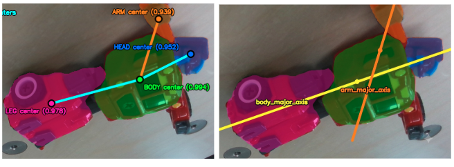
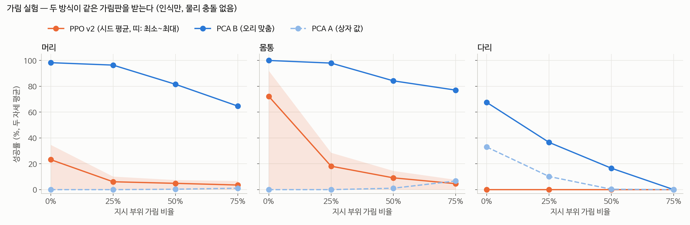

# isaac-grasp-bench

> **한 줄 요약**
> 로봇 팔이 물체를 집는 두 가지 방법 — **규칙 기반 알고리즘(PCA)** 과 **강화학습(PPO)** — 을
> 시뮬레이션에서 **같은 조건으로** 겨루게 하고, 그 차이가 **진짜인지 우연인지** 가린 기록.

> **결론부터 (오리 장난감, 지시 부위 파지)**
> - 머리·몸통: PCA **99~100%**, PPO **80~92%**. 다리: PCA **48~82%**, PPO **0%**.
> - 6개 조건 모두 차이가 노이즈보다 컸고, 방향은 전부 PCA였다.
> - 단, PCA는 **완벽한 부위 분할**을 받았고, PPO는 **시드 3개·1500 iteration**이다. 물체는 **사진 기반 근사 모형**이다.
> - **2차(조건 맞춤)**: PPO에도 PCA와 같은 "보이는 점군"만 주자 머리 22~24%·몸통 72~73%로 떨어졌다(시드 6개).
>   둘 다 상자 설정이면 머리·몸통은 **판단 보류**다. → [2차 결과](#2차--조건을-더-맞춘-비교)
> - **3차(가림)**: 지시 부위를 25~75% 가리면 PPO 몸통은 72% → 18~5%, PCA 몸통은 100% → 98~77%. → [3차 결과](#3차--가림-실험)

---

## 1. 이게 무슨 프로젝트인가

### 배경 — 실기에서 겪은 것



*실기 파이프라인([cobot2_jarvis](https://github.com/Dmk1999s/cobot2_jarvis)):
YOLO로 물체를 분할하고(왼쪽), 그 점들에 PCA를 걸어 긴 방향을 찾는다(오른쪽).*

- 부트캠프 팀 프로젝트에서 두산 M0609 로봇 팔 + OnRobot RG2 그리퍼로 장난감을 회수했다.
  "오리 몸통 집어와"처럼 **지시한 부위**를 잡는 과제였다.
- 기간 제약 때문에 **점군 PCA 파지 규칙**으로 완성했다. **동작은 했다.**
- 그런데 말할 수 없는 게 있었다 — **"어떤 조건에서 왜 실패하는가?"**
  실기에서는 물체 자세도, 마찰도 통제할 수 없다.

> **"잘 됩니다"** 와 **"이 조건에서 이만큼 실패하고, 그 이유는 이것입니다"** 는 다른 말이다.
> 이 프로젝트는 **후자를 할 수 있게 만드는 것**이 목적이다.

### 그래서 하는 것

시뮬레이션(AWS GPU + Isaac Lab)으로 옮겨 조건을 통제하고 —

1. 실기 PCA 규칙을 **그대로 이식**해 어디서 실패하는지 잰다.
2. 같은 조건에서 강화학습(PPO) 정책을 학습시켜 **나란히** 잰다.
3. 두 방식의 차이가 **측정 노이즈보다 큰지** 확인한다. 작으면 **판단 보류**로 적는다.

- 두 방식 사이에 달라지는 변수는 **제어 방식 하나뿐**이다.
  둘 다 같은 Franka Panda 로봇, 같은 물체 배치, 같은 평가 시드, 같은 성공 판정 코드를 쓴다.
- 앞선 상자(직육면체) 실험 기록은 [PROGRESS.md](PROGRESS.md)와 [docs/](docs/)에 있다.

---

## 2. 용어 (모르면 여기부터)

| 용어 | 뜻 |
|---|---|
| **PCA 파지 규칙** | 점 구름에서 **가장 길게 퍼진 방향**(주성분)을 계산하고, 거기 **수직으로** 그리퍼를 벌려 잡는 규칙 기반 알고리즘. 학습이 없다. 실기 코드를 그대로 옮겼다. |
| **PPO (강화학습)** | 시뮬레이터에서 시행착오하며 보상을 많이 받는 행동을 **스스로** 익히는 알고리즘. 여기서는 4096개 환경을 동시에 돌려 1500번 반복 학습했다. |
| **지시 부위** | 잡으라고 지정한 부위. 머리·몸통·다리 중 하나. 팀 프로젝트의 부위 어휘를 그대로 썼다. |
| **근사 모형** | 실제 장난감의 3D 스캔이 아니라, **사진 1장의 부위 비율**로 만든 타원체 조합. 크기·무게·마찰은 가정값이다. |
| **고무 근사** | 물체는 강체로 두고 **닿는 면만 스프링처럼 눌리게** 한 설정(부드러운 접촉). 쥘 때 손가락당 약 2.5mm 눌린다. 몸통 전체가 휘지는 않는다. |
| **성공** | 두 손가락이 모두 **지시 부위에 닿은 채** 물체를 10cm 이상 들어 **0.5초 유지**. 들어도 다른 부위를 잡았으면 실패다. |
| **실패 대조군** | 일부러 틀리게 잡게 한 실행. 판정이 정말 틀린 파지를 실패로 세는지 확인하는 용도. |
| **시드(seed)** | 난수를 정하는 값. **같은 설정이라도 시드가 다르면 다른 정책이 나온다.** 그래서 PPO는 시드를 바꿔 여러 번 학습한다. |
| **에피소드** | 물체 하나를 집으려 한 시도 1회. |
| **노이즈** | 반복할 때마다 흔들리는 폭. 여기서는 PPO 시드 간 범위와 PCA 평가 시드 간 범위 중 큰 값. |
| **판단 보류** | 두 방식의 차이가 노이즈보다 작다는 뜻. "차이 없음"이 아니라 **"이 데이터로는 말할 수 없음"** 이다. |

---

## 3. 오리 장난감 — 지시 부위 파지 (2026-10-19)

> 상세: [docs/duck_experiment.md](docs/duck_experiment.md) · 모형: [assets/duck/README.md](assets/duck/README.md)

### 물체: 사진 기반 근사 모형


| 항목 | 값 | 근거 |
|---|---|---|
| 형상 | 타원체 5개 (머리, 부리, 몸통, 발 2개) | 사진의 부위 윤곽 비율 |
| 크기 | 길이 144 × 폭 51 × 높이 55 mm | **가정** — 사진에 크기 기준이 없다 |
| 질량·마찰 | 60 g, 정/동 1.0 / 0.8 | **가정** (고무) |
| 부위 라벨 | 카메라 의미 분할과 형상 판정 일치율 99.9~100% | 시뮬레이터에서 확인 |

### 실험 조건

- **조건**: 지시 부위 {머리, 몸통, 다리} × 자세 {엎드림, 옆으로} × 무작위 회전
- **PCA 입력**: 위에서 보이는 면의 점군 + 부위 라벨. 오차 없는 분할이다.
- **PPO 입력**: 로봇 관절 상태, 물체 위치·자세, 지시 부위 위치
- **규모**:
  - 셀당 320 에피소드 (환경 64개 × 평가 시드 5개)
  - PPO는 학습 시드 3개, 하이퍼파라미터는 상자 실험과 같다.

### 판정이 믿을 만한가 — 실패 대조군

| 조건 | 들어올림 (부위 무관) | 성공 (지시 부위) |
|---|---:|---:|
| PCA 정상 | 96.8% | 88.2% |
| 일부러 다른 부위를 지시 | 99.8% | **0.0%** |
| 파지 위치 20 cm 어긋남 | 0.0% | **0.0%** |

→ 판정은 "들었는가"가 아니라 **"지시한 부위를 잡았는가"** 를 잰다.

### 결과


| 지시 부위 | 자세 | PCA | PPO (시드 평균) | PPO 시드별 | 차이 | 노이즈 | 판정 |
|---|---|---:|---:|---|---:|---:|---|
| 머리 | 엎드림 | 99.4% | 82.3% | 82 / 78 / 87 | +17.1%p | 9.1%p | PCA 우세 |
| 머리 | 옆으로 | 100.0% | 80.1% | 82 / 72 / 86 | +19.9%p | 14.1%p | PCA 우세 |
| 몸통 | 엎드림 | 100.0% | 92.0% | 89 / 92 / 94 | +8.0%p | 4.7%p | PCA 우세 |
| 몸통 | 옆으로 | 100.0% | 92.0% | 91 / 90 / 95 | +8.0%p | 5.6%p | PCA 우세 |
| 다리 | 엎드림 | 47.5% | 0.0% | 0 / 0 / 0 | +47.5%p | 14.1%p | PCA 우세 |
| 다리 | 옆으로 | 82.2% | 0.0% | 0 / 0 / 0 | +82.2%p | 7.8%p | PCA 우세 |


- **PPO는 다리를 전혀 잡지 못했다.** 3개 시드 모두 거의 전부 "못 들어올림"이다.
  작은 발(18×15×12 mm)을 잡는 법을 이 학습 예산에서 배우지 못했다.
- **PPO의 머리 실패는 주로 바로 옆 몸통을 잡은 경우**다(약 10%).
- **PCA의 다리·엎드림 실패**: 발이 몸통 아래쪽에 숨어 있어 손가락이 몸통에 닿는다.

### 실기 상수의 함정 — 파지 깊이


- 실기 원래 값(깊이 15 mm)으로는 **머리·몸통 성공률이 0%** 다.
  손끝이 둥근 부위의 가장 넓은 단면보다 위를 쥐어 오리가 수박씨처럼 튕겨 나간다.
- 형상으로 계산한 필요 깊이는 22~27 mm이고, 성공률이 급변하는 지점과 일치한다.
  그래서 본실험은 **28 mm**로 정했다. 성공률을 보고 고른 값이 아니다.
- 다리는 반대로 21 mm 근처가 가장 좋다 → **고정 깊이 하나로는 모든 부위를 만족할 수 없다.**

### 고무 근사의 효과

- 강체와 비교하면 쥘 때 손가락 사이가 **4.8~5.5 mm 더 좁아졌다**(눌림이 표현됨).
- 성공률 차이는 다리·엎드림(+7.5%p)을 빼면 1%p 이내다.

### 비교의 한계

1. **물체가 실물이 아니다.** 사진 비율에 크기·무게·마찰을 가정했다.
2. **PCA에 유리하다.**
   - 완벽한 부위 분할을 받았다. 실기에는 분할 오차가 있다.
   - 파지 깊이를 이 물체의 형상 계산으로 맞췄다.
3. **PPO에 불리하다.** 오리용 튜닝이 없고, 시드 3개·1500 iteration뿐이다.
4. **가림은 인식만 가렸다(3차).** 실제 물체 충돌·밀림은 없고, 두 방식 모두 가림용 조정·학습이 없다.
5. **판정 기준을 결과를 본 뒤 한 번 바꿨다.**
   - "그리퍼 중심이 부위 안" 기준은 두 발을 한꺼번에 쥔 파지를 실패로 셌다.
   - "두 손가락이 모두 지시 부위에 닿음"으로 바꾸고 **전부 다시 평가했다.**
   - 이전 결과는 `eval/duck_v1_tcp_criterion/`에 있다.
6. **실물 전이는 검증하지 않았다.**

### 2차 — 조건을 더 맞춘 비교


- **PPO v2**: 물체 실제 위치·자세 대신 PCA와 **같은 보이는 점군**(6000점)에서 뽑은 부위 정보만 관측한다. 보상도 손가락 접촉 기준이다.
- **시나리오 A**: PCA도 상자 실험 값(깊이 15 mm) 그대로 쓴다. **B**: PCA만 오리 형상에 맞춘다(28 mm).
- 모든 실행의 물체 스폰 위치·자세 차이는 0이다.

| 지시 부위 | 자세 | PCA A | PCA B | PPO v0 | PPO v2 (시드별) | A 판정 | B 판정 |
|---|---|---:|---:|---:|---|---|---|
| 머리 | 엎드림 | 0.0% | 96.6% | 82.3% | 24.1% (26/29/0/26/36/27) | 판단 보류 | PCA 우세 |
| 머리 | 옆으로 | 0.0% | 100.0% | 80.1% | 22.3% (26/29/0/22/33/23) | 판단 보류 | PCA 우세 |
| 몸통 | 엎드림 | 0.0% | 100.0% | 92.0% | 71.8% (79/90/0/82/89/90) | 판단 보류 | 판단 보류 |
| 몸통 | 옆으로 | 0.0% | 100.0% | 92.0% | 72.7% (82/88/1/82/94/90) | 판단 보류 | 판단 보류 |
| 다리 | 엎드림 | 0.0% | 52.2% | 0.0% | 0.0% (0 × 6) | 판단 보류 | PCA 우세 |
| 다리 | 옆으로 | 65.9% | 82.8% | 0.0% | 0.0% (0 × 6) | PCA 우세 | PCA 우세 |

- PPO v2 **시드 6개 중 1개(시드 3)가 학습 중 붕괴**했다(0%). 시드 범위가 커져 몸통이 판단 보류가 됐다.
- 1차 PPO의 높은 성공률은 **정답 위치·자세를 관측한 덕**이 컸다.
- 상세: [docs/duck_experiment.md](docs/duck_experiment.md#2차--조건을-더-맞춘-비교-2026-10-19)

### 3차 — 가림 실험



- 위에서 볼 때 한쪽을 덮는 **가림판**으로 지시 부위의 보이는 점 25/50/75%를 숨긴다. **인식만** 가리고, PCA와 PPO v2가 **같은 판**을 받는다.

| 지시 부위 | 방식 | 가림 0% | 25% | 50% | 75% |
|---|---|---:|---:|---:|---:|
| 머리 | PCA B | 98.3% | 96.4% | 81.6% | 64.7% |
| 머리 | PPO v2 | 23.2% | 6.1% | 4.9% | 3.6% |
| 몸통 | PCA B | 100.0% | 98.0% | 84.2% | 77.0% |
| 몸통 | PPO v2 | 72.2% | 18.2% | 9.1% | 4.6% |
| 다리 | PCA B | 67.5% | 36.6% | 16.6% | 0.0% |
| 다리 | PPO v2 | 0.0% | 0.0% | 0.0% | 0.0% |

- **PPO v2는 25%만 가려도 크게 무너진다.** 가림 없이 학습했고, 관측(보이는 점 중심)이 가림으로 밀려나기 때문이다.
- **PCA는 서서히 떨어진다.** 다리는 점이 부족하면 팀 코드가 **잡기를 거부**한다(75% 가림에서 100%).
- 가림 25% 이상에서는 몸통도 PCA 우세로 판정됐다.
- 한계: 인식만 가렸다. PPO를 가림을 섞어 학습하면 달라질 수 있다.

### 재현

```bash
# AWS g5.2xlarge (A10G 24GB) / Ubuntu 22.04 / Isaac Sim 5.1.0 + Isaac Lab v2.3.2
bash scripts/setup.sh                                    # 환경 구축 (멱등)
source scripts/env.sh
$PY -m pytest -q tests                                   # 단위 테스트
$PY scripts/build_duck_usd.py                            # 오리 모형 (고무 근사)
$PY scripts/build_duck_usd.py --rigid --out assets/duck/duck_rigid.usda
$PY scripts/check_duck_asset.py                          # 모형 물리·라벨 검증
bash scripts/run_duck_depth_sweep.sh                     # PCA 파지 깊이 훑기
bash scripts/train_duck_seeds.sh                         # PPO 시드 1~3 (시드당 ~40분)
bash scripts/run_duck_main.sh                            # PCA·강체·대조군·PPO 평가
$PY scripts/analyze_duck.py --dir /data/isaac-grasp-bench/eval/duck --fig docs/img/duck
```

| 결과물 | 위치 |
|---|---|
| 원자료 (에피소드별) | `eval/duck/*.csv` |
| 요약 표 | `eval/duck/summary.md` |
| 그림 | `docs/img/duck/` |
| PPO 체크포인트 | `checkpoints/duck/` (v0), `checkpoints/duck_v2/` (v2) |
| 2차 원자료·요약 | `eval/duck_aligned/` |
| 3차(가림) 원자료·요약 | `eval/duck_occlusion/` |
