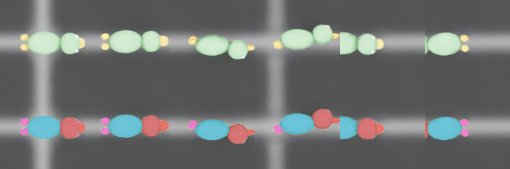

# 오리 장난감 근사 모형

> ⚠ **실제 장난감의 3D 모형이 아니다.** 사진 1장(`reference_photo.png`)에서 부위 비율을 재고,
> 절대 크기·높이·질량·마찰은 **가정**한 근사 모형이다. 실험 결과를 인용할 때 이 점을 같이 적는다.



## 출처

- 물체와 부위 이름: 팀 프로젝트 [cobot2_jarvis](https://github.com/Dmk1999s/cobot2_jarvis).
  물체는 `duck`이고 부위는 `head / body / leg`다. 재질은 `rubber`로 적혀 있다.
- 형상 비율: `reference_photo.png`. Mask R-CNN 부위 윤곽이 그려진 위에서 본 사진으로,
  엎드린 오리를 찍은 것으로 해석했다.

## 수치

| 항목 | 값 | 근거 |
|---|---|---|
| 전체 길이 (부리 끝~발 끝) | 144 mm | **가정** — 사진 283 px × 0.53 mm/px. 사진에 크기 기준물이 없다 |
| 몸통 | 76 × 51 × 45 mm | 길이·폭은 사진 비율, 높이는 **가정**(폭 × 0.88) |
| 머리 (부리 포함) | 61 × 48 × 44 mm | 사진 비율 |
| 발 2개 | 18 × 15 × 12 mm | 사진 비율 |
| 질량 | 60 g | **가정** (속이 빈 고무 장난감) |
| 마찰 (정/동), 반발 | 1.0 / 0.8, 0 | **가정** (고무) |
| 강체 여부 | 강체 | 실제 장난감은 눌리면 변형된다. 그 효과는 빠져 있다 |

크기 전체는 `scripts/build_duck_usd.py --scale`로 바꾼다.
나머지 수치는 `src/toy_duck.py` 한 곳에서 정의한다.
실측값이 생기면 여기만 고치면 된다.

## 표현 방식

- **부위 = 타원체**: head는 머리와 부리, body는 몸통, leg1·leg2는 발이다.
- **충돌 형상**: 타원체마다 보이지 않는 거친 볼록 메시를 하나씩 둔다.
  눈에 보이는 메시는 따로 있는 고해상도 메시다.
- **부위 라벨**: 부위마다 `UsdSemantics` 라벨(`class=head|body|leg`)을 붙였다.
  그래서 카메라 의미 분할이 픽셀마다 부위를 알려준다.
- **부위 판정**: `toy_duck.classify_points(로컬 좌표)`가 점이 어느 부위인지 판정한다.
  파지 성공 판정에서는 두 손가락 끝의 중점을 넣는다.

## 시뮬레이터 검증 (2026-10-19, g5.2xlarge, Isaac Sim 5.1)

`scripts/check_duck_asset.py`: 자세 6개로 8cm 위에서 떨어뜨리고 3초 뒤를 측정했다.
대조군으로 반지름 25mm 해석적 구를 함께 떨어뜨렸다.

| 항목 | GPU 물리 | CPU 물리 |
|---|---|---|
| 대조군 구의 바닥 오차 | 0.0 mm | 0.0 mm |
| 오리의 바닥 오차 (6자세) | −0.82 ~ +0.26 mm | −0.82 ~ +0.26 mm |
| 3초 뒤 선속도 | 0.6 ~ 5.5 mm/s | 0.0 |
| PhysX가 읽은 질량 | 0.060 kg | 0.060 kg |
| 카메라 부위 라벨과 형상 판정의 일치율 | 100% (6/6 자세) | 99.9~100% |

전체 값은 `eval/duck_asset_check/{gpu,cpu}/summary.json`에 있다.

### 검증 중에 고친 것

- **첫 모형은 바닥에 2.3mm 파묻혔다.** 대조군 구는 0.0mm였다.
  - `hullVertexLimit=255`와 `restOffset=0`을 명시해도 수치가 그대로였다.
  - 꼭짓점 315개짜리 메시를 PhysX가 자체적으로 단순화하면서 안쪽으로 깎은 것으로 판단했다.
  - 64개 이하(52개)의 충돌 메시를 직접 만들고, 오차가 ±로 퍼지도록 4.1% 부풀렸다.
  - 그 결과 오차가 ±0.8mm 이내로 줄었다. 예측 범위는 ±4.1% × 반축 ≈ ±1mm였다.

### 남은 한계

- 절대 크기·높이·질량·마찰이 가정값이다. 실측 1회면 크게 줄어든다.
  우선순위는 전체 길이 → 무게 → 몸통 높이 순이다.
- GPU 물리에서 3초 뒤에도 수 mm/s의 미세 진동이 남는다. CPU에서는 0이다.
- 강체라서 눌림과 변형이 없다. 실제 고무 오리를 잡을 때와 접촉 양상이 다르다.
- 그리퍼 파지는 아직 검증하지 않았다. 여기서 확인한 것은 **모형이 시뮬레이터에서
  의도대로 표현되는가**까지다.

## 재현

```bash
source scripts/env.sh
$PY -m pytest -q tests/test_toy_duck.py
$PY scripts/build_duck_usd.py                 # assets/duck/duck.usda
$PY scripts/check_duck_asset.py --out /data/isaac-grasp-bench/eval/duck_asset_check_cuda
$PY scripts/check_duck_asset.py --device cpu --out /data/isaac-grasp-bench/eval/duck_asset_check_cpu
```
