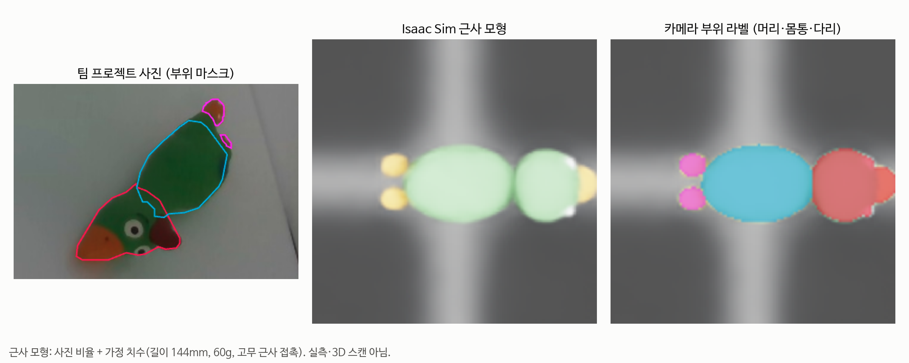
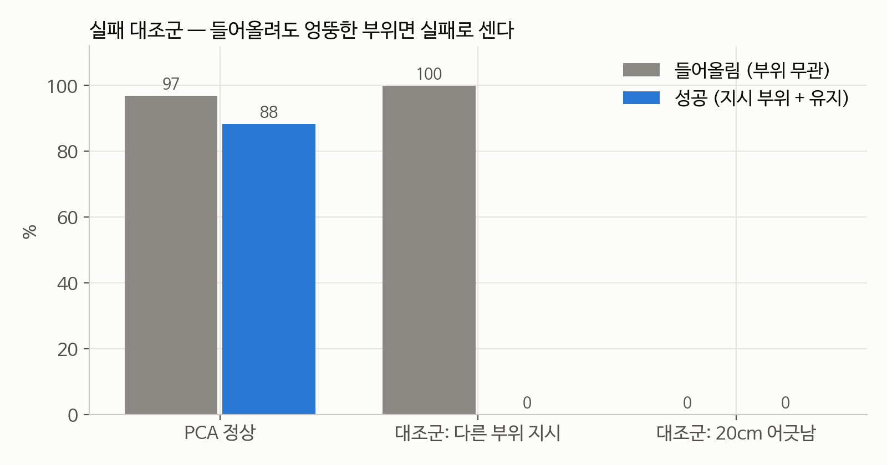
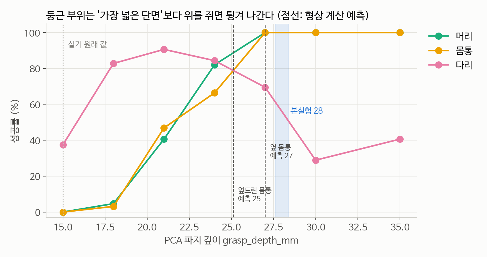
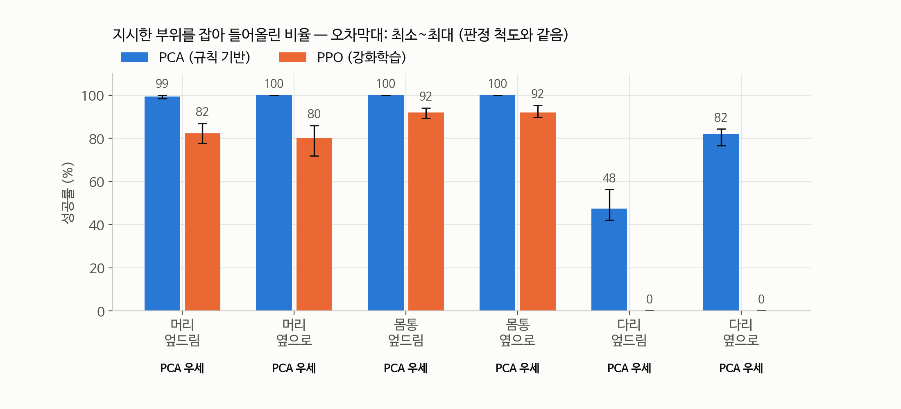
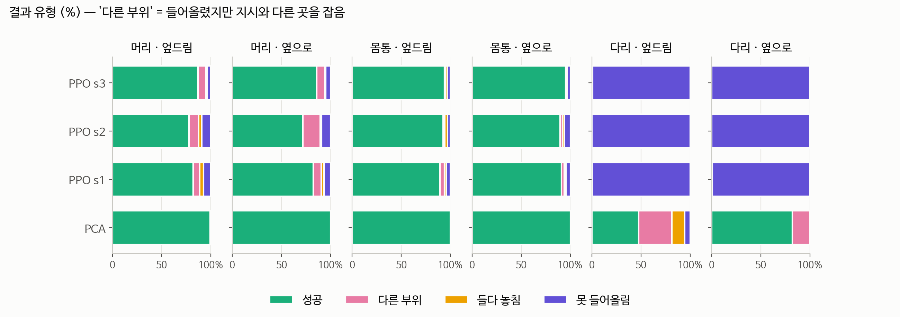
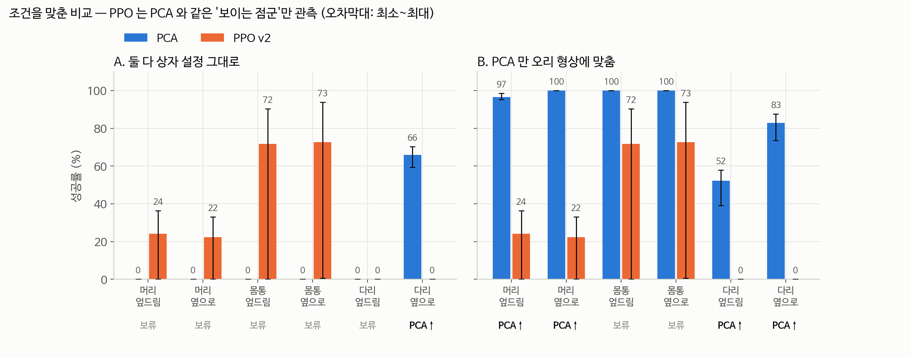

# 오리 장난감: "지시한 부위를 잡아 들어올리기" — PCA vs PPO

> 실행: 2026-10-19, AWS g5.2xlarge (A10G 24GB, us-east-2), Isaac Sim 5.1 / Isaac Lab v2.3.2
> 원자료: `eval/duck/*.csv` · 표: `eval/duck/summary.md` · 그림: `docs/img/duck/`

## 한 장 요약

- 팀 프로젝트의 오리 장난감(머리·몸통·다리 2개)을 **사진 1장 기반 근사 모형**으로 Isaac Lab에 넣었다.
- PCA 규칙 기반 파지와 PPO 강화학습을 같은 로봇·물체 배치·평가 시드·성공 판정으로 비교했다.
- **6개 조건 모두 차이가 노이즈보다 컸고, 방향은 전부 PCA 쪽이었다.**
  노이즈는 PPO 시드 범위와 PCA 평가 시드 범위 중 큰 값이다.
- 단, 이 "PCA 우세"에는 조건이 붙는다. 아래 [비교의 한계](#비교의-한계)를 함께 인용해야 한다.
  1. PCA는 완벽한 부위 분할을 받았다.
  2. PCA 파지 깊이는 형상 계산으로 맞췄다.
  3. PPO는 학습 예산 1500 iteration, 시드 3개뿐이다.

---

## 슬라이드 1 — 물체: 사진 기반 근사 모형



| 항목 | 값 | 근거 |
|---|---|---|
| 형상 | 타원체 5개 (머리, 부리, 몸통, 발 2개) | 사진의 부위 윤곽 비율 |
| 크기 | 길이 144 × 폭 51 × 높이 55 mm | **가정** — 사진에 크기 기준이 없다 |
| 질량·마찰 | 60 g, 정/동 1.0/0.8 | **가정** (고무) |
| 고무 근사 | 부드러운 접촉 k=2×10⁴ N/m, c=50 | 쥘 때 손가락당 ~2.5 mm 눌림. 측정치 2.4~2.7 mm로 일치 |
| 부위 라벨 | 카메라 의미 분할 = 형상 판정, 일치율 99.9~100% | `assets/duck/README.md` |

## 슬라이드 2 — 실험 설계

- **같게 둔 것**: Franka Panda + 그리퍼, IK-Rel 액션, 물체 배치(평가 시드 1000~1004), 성공 판정 코드
- **조건**: 지시 부위 {머리, 몸통, 다리} × 자세 {엎드림, 옆으로} × 무작위 회전(yaw)
- **관측**
  - PCA: 위에서 보이는 면의 점군 + 부위 라벨 (z-버퍼로 자기 가림 반영)
  - PPO: 물체 위치·자세, 지시 부위 위치, 원-핫 벡터
- **성공 기준**: 두 손가락 면이 모두 지시 부위에 닿은 채 물체가 0.10 m 이상 들려 0.5초 유지
- **규모**
  - PCA: 셀당 320 에피소드 (환경 64개 × 평가 시드 5개)
  - PPO: 학습 시드 3개 × 같은 320 에피소드
  - PPO 학습: 4096 환경 × 1500 iteration, 하이퍼파라미터는 큐브 실험과 동일
- **판정**
  - |차이| > 노이즈(PPO 시드 범위와 PCA 평가 시드 범위 중 큰 값)일 때만 우세를 주장한다.
  - 그렇지 않으면 판단 보류로 적는다.

## 슬라이드 3 — 판정이 믿을 만한가: 실패 대조군



| 조건 | 들어올림 (부위 무관) | 성공 (지시 부위) |
|---|---:|---:|
| PCA 정상 | 96.8% | 88.2% |
| 대조군: PCA에 일부러 다른 부위를 지시 | 99.8% | **0.0%** |
| 대조군: 파지 위치 20 cm 어긋남 | 0.0% | **0.0%** |

→ 판정은 "들었는가"가 아니라 **"지시한 부위를 잡았는가"** 를 잰다.

## 슬라이드 4 — 실기 상수의 함정: 파지 깊이



- 실기 원래 값(깊이 15 mm)으로 돌리면 **머리·몸통 0%**다.
  - 손끝이 둥근 부위의 가장 넓은 단면보다 위를 쥐어 오리가 수박씨처럼 튕겨 나간다.
  - 추적 결과: 그리퍼가 닫히는 동안 오리가 옆으로 최대 10 cm 밀려났다.
- 형상으로 계산한 필요 깊이:

  | 엎드린 머리 | 엎드린 몸통 | 옆 머리 | 옆 몸통 |
  |---:|---:|---:|---:|
  | 22.2 mm | 25.1 mm | 25.3 mm | 27.0 mm |

  성공률이 급변하는 위치가 이 예측과 맞는다.
- 본실험 깊이는 **28 mm**다. 성공률을 보고 고르지 않고, 머리·몸통 조건을 모두 만족하는 최소 정수로 정했다.
- **다리는 반대로 움직인다.** 21 mm 근처가 가장 좋고, 깊어질수록 바닥과 부딪혀 나빠진다.
  → **고정 깊이 하나로는 모든 부위를 만족할 수 없다.** PCA의 구조적 한계다.

## 슬라이드 5 — 결과: PCA vs PPO



| 지시 부위 | 자세 | PCA | PPO (시드 평균) | PPO 시드별 | 차이 | 노이즈 | 판정 |
|---|---|---:|---:|---|---:|---:|---|
| 머리 | 엎드림 | 99.4% | 82.3% | 82 / 78 / 87 | +17.1%p | 9.1%p | PCA 우세 |
| 머리 | 옆으로 | 100.0% | 80.1% | 82 / 72 / 86 | +19.9%p | 14.1%p | PCA 우세 |
| 몸통 | 엎드림 | 100.0% | 92.0% | 89 / 92 / 94 | +8.0%p | 4.7%p | PCA 우세 |
| 몸통 | 옆으로 | 100.0% | 92.0% | 91 / 90 / 95 | +8.0%p | 5.6%p | PCA 우세 |
| 다리 | 엎드림 | 47.5% | 0.0% | 0 / 0 / 0 | +47.5%p | 14.1%p | PCA 우세 |
| 다리 | 옆으로 | 82.2% | 0.0% | 0 / 0 / 0 | +82.2%p | 7.8%p | PCA 우세 |

## 슬라이드 6 — 실패 사례



- **PPO의 다리 지시는 3개 시드 모두 0%다.**
  - 거의 전부 "못 들어올림"이다. 물체 최고 높이 중앙값이 22 mm로, 놓인 높이 그대로다.
  - 이 학습 예산에서는 작은 부위(발 18×15×12 mm)를 잡는 법을 배우지 못했다.
- **PPO의 머리·몸통 실패**: 다른 부위를 잡음(1~18%) + 못 들어올림(3~9%)
- **PCA의 다리·엎드림 실패**: 다른 부위를 잡음 34%, 들다 놓침 13%
  - 발이 몸통 아래쪽에 숨어 있어 손가락이 몸통에 닿는다.

## 슬라이드 7 — 고무 근사의 효과 (PCA, 같은 조건)

| 부위·자세 | 성공 (고무) | 성공 (강체) | 눌림 |
|---|---:|---:|---:|
| 머리·엎드림 | 99.4% | 99.1% | 5.5 mm |
| 몸통·엎드림 | 100% | 100% | 5.4 mm |
| 다리·엎드림 | 47.5% | 40.0% | 5.0 mm |
| 다리·옆으로 | 82.2% | 81.2% | 1.8 mm |

- 쥘 때 손가락 사이가 4.8~5.5 mm 줄었다(양쪽 합). 눌림은 의도대로 표현됐다.
- 성공률 차이는 다리·엎드림(+7.5%p)을 빼면 1%p 이내다.

---

## 2차 — 조건을 더 맞춘 비교 (2026-10-19)

> 원자료: `eval/duck_aligned/*.csv` · 표: `eval/duck_aligned/summary_aligned.md` · 그림: `img/duck/fig6_aligned_scenarios.png`
> 체크포인트: `checkpoints/duck_v2/` (하이퍼파라미터 기록 `params_seed*/`)

1차 비교의 불공정 두 가지를 줄였다.

1. **PPO 관측을 PCA와 같게 (PPO v2)**
   - 물체의 실제 위치·자세 관측을 뺐다. 대신 PCA가 받는 것과 **같은 "위에서 보이는 점군"** (점 6000개, 2.5 mm 격자 z-버퍼)에서 부위별 중심·점 개수·주축 방향만 준다.
   - 학습 보상도 평가 기준과 같은 **"두 손가락이 지시 부위에 닿음"** 으로 바꿨다.
   - 하이퍼파라미터와 보상 가중치는 큐브 실험 그대로다. 4096 환경 × 1500 iteration, 시드 6개 (1~3을 먼저, 4~6을 다음 날 추가).
2. **PCA도 오리에 맞추지 않는 경우 (시나리오 A)**
   - A: 상자 실험 값 그대로 (깊이 15 mm, 바닥 여유 30 mm)
   - A': 상자 실험 보정값 (깊이 15, 바닥 여유 10)
   - B: 1차와 같이 오리 형상에 맞춘 값 (깊이 28, 바닥 여유 5)
   - 이번에는 PCA 점군도 6000개로 줄여 PPO v2와 같게 했다. 1차는 12000개였다.

### 배치가 정말 같은가

- 모든 실행에서 **스폰 위치·자세 차이가 0.000**이다.
- 안착 위치의 최대 5 mm 차이는 접근 중 그리퍼가 물체를 건드린 결과로, 스폰 이후 일이다.
- PCA를 v0 태스크와 v2 태스크에서 돌린 결과가 **에피소드 단위로 100% 같다.** 태스크 교체가 결과를 바꾸지 않는다.
- PPO v0 재평가 결과가 1차 숫자와 그대로 일치한다.

### 결과



| 지시 부위 | 자세 | PCA A (상자 값) | PCA A' | PCA B (오리 맞춤) | PPO v0 | PPO v2 (시드별) | A 판정 | B 판정 |
|---|---|---:|---:|---:|---:|---|---|---|
| 머리 | 엎드림 | 0.0% | 0.0% | 96.6% | 82.3% | 24.1% (26 / 29 / 0 / 26 / 36 / 27) | 판단 보류 | PCA 우세 |
| 머리 | 옆으로 | 0.0% | 0.0% | 100.0% | 80.1% | 22.3% (26 / 29 / 0 / 22 / 33 / 23) | 판단 보류 | PCA 우세 |
| 몸통 | 엎드림 | 0.0% | 0.0% | 100.0% | 92.0% | 71.8% (79 / 90 / 0 / 82 / 89 / 90) | 판단 보류 | 판단 보류 |
| 몸통 | 옆으로 | 0.0% | 0.0% | 100.0% | 92.0% | 72.7% (82 / 88 / 1 / 82 / 94 / 90) | 판단 보류 | 판단 보류 |
| 다리 | 엎드림 | 0.0% | 15.0% | 52.2% | 0.0% | 0.0% (0 × 6) | 판단 보류 | PCA 우세 |
| 다리 | 옆으로 | 65.9% | 64.4% | 82.8% | 0.0% | 0.0% (0 × 6) | PCA 우세 | PCA 우세 |

판정은 PCA와 PPO v2를 비교한 것이다. 노이즈는 PPO v2 시드 범위와 PCA 평가 시드 범위 중 큰 값이다.

### 읽는 법

- **둘 다 상자 설정이면 머리·몸통은 판단 보류다.**
  - PCA는 0%다(전부 "못 들어올림", 1차 깊이 훑기와 같은 원인).
  - PPO v2는 22~73%이지만 시드 3이 0%라 시드 범위가 차이보다 크다.
  - 다리·옆으로만 PCA 우세다(65.9% vs 0%).
- **PPO v2 시드 3은 학습이 무너졌다. 6개 중 1개다.**
  - 학습 중반 평균 보상이 −24.9까지 떨어진 뒤 회복하지 못했다. 평가에서는 99% 이상이 "못 들어올림"이다.
  - 시드 4~6을 추가한 이유는 이 붕괴가 우연인지 보기 위해서다. 4~6은 모두 정상 학습됐다.
  - 이 시드는 판정에서 빼지 않았다. 시드 붕괴도 이 설정의 재현성 결과다.
  - 노이즈를 시드 **범위**로 재기 때문에, 시드를 늘려도 범위는 줄지 않는다. 시드 추가로 판정이 바뀔 수 없다는 것을 실행 전에 알고 진행했다.
  - **참고(판정 아님)**: 시드 3을 빼면 PPO v2는 머리 27~29%, 몸통 86~87%, 시드 범위 11~12%p다.
    이 경우 시나리오 B 몸통은 차이 13~14%p > 범위로 PCA 쪽이지만, 결과를 본 뒤 시드를 고른 것이라 판정으로 쓰지 않는다.
- **관측을 점군으로 제한하자 PPO가 크게 떨어졌다** (v0 → v2).
  - 머리 81% → 22~24%, 몸통 92% → 72~73% (6시드 평균).
  - 정상 학습된 시드만 보면 몸통 79~94%, 머리 22~36%다. 머리 실패는 주로 못 들어올림과 다른 부위(몸통) 잡음이다.
  - 1차의 PPO는 정답 위치·자세를 받는 이점이 있었다는 뜻이다.
- **PCA 점 개수 12000 → 6000**: 머리·엎드림 99.4 → 96.6%, 다리 47.5 → 52.2%, 82.2 → 82.8%. 판정은 같다.
- **실패 대조군**은 이번에도 정상이다: 다른 부위 지시 시 들어올림 99.5%, 성공 0%. 20 cm 어긋남 0%.

### 2차의 한계

1. PPO v2도 오리용 튜닝은 없다. 관측 구성(부위 중심·점 개수·주축)은 내가 설계했고, 다른 설계면 결과가 달라질 수 있다.
2. 시드 6개 중 1개가 붕괴해 노이즈(시드 범위)가 매우 크다. 몸통 판정이 보류된 직접 원인이다. 범위 기준이라 시드를 더 늘려도 이 보류는 풀리지 않는다.
3. PCA는 여전히 오차 없는 부위 라벨을 받는다. PPO v2도 같은 라벨로 부위별 점군을 받으므로 이 점은 양쪽이 같다.
4. 가림(다른 물체에 의한)은 여전히 하지 않았다. 자기 가림만 양쪽 입력에 같게 들어간다.

### 재현 (2차)

```bash
TASK=IsaacGraspBench-Lift-Duck-Franka-IK-Rel-v2 EXP=franka_lift_duck_v2 TAG=duck_v2 \
  SEEDS="1 2 3 4 5 6" bash scripts/train_duck_seeds.sh   # PPO v2 시드 1~6 (시드당 ~1시간)
bash scripts/run_duck_aligned.sh                         # PCA A/A'/B·대조군·PPO v0/v2 평가
$PY scripts/analyze_duck_aligned.py --dir /data/isaac-grasp-bench/eval/duck_aligned --fig docs/img/duck
```

### 2차 AWS 사용

- 같은 인스턴스(i-04a9f52ce590a31f6)를 사용자가 다시 켰다. 학습·평가는 2026-10-19 약 15:00~19:00 (서버 시각)에 돌았다.
- 끝난 뒤 결과를 로컬로 옮기고 OS에서 종료했다.
- 시드 4~6: 사용자가 다시 켠 뒤 2026-10-20 01:14~04:46 (UTC, 약 3.5시간). 끝난 뒤 다시 OS에서 종료했다. 콘솔에서 stopped 상태 확인이 필요하다.
- 재시작 시 주의: Omniverse 캐시가 인스턴스 스토어(`/opt/dlami/nvme`)에 있어 stop 때마다 지워진다. 시작할 때마다 `bash scripts/setup_cache.sh`를 먼저 돌려야 로봇 에셋을 받을 수 있다.

---

## 비교의 한계

1. **물체가 실물이 아니다.** 사진 1장의 비율에 크기·질량·마찰을 가정했다. 실측 길이와 무게만 있어도 크게 나아진다.
2. **고무는 근사다.** 접촉면만 눌린다. 몸통이 휘는 전체 변형은 없다.
3. **PCA에 유리한 조건이다.**
   - PCA는 **완벽한 부위 라벨**을 받았다. 실기에서는 Mask R-CNN 분할 오차가 있다.
   - 파지 깊이를 이 물체의 형상 계산으로 맞췄다. 사람이 물체 지식을 넣은 셈이다.
   - PPO 하이퍼파라미터와 보상 구조는 큐브 실험 그대로이고, 오리에 맞춘 튜닝은 하지 않았다.
4. **PPO 학습 예산이 작다.** 1500 iteration, 시드 3개다. 더 길게 학습하거나 보상을 바꾸면 결과가 달라질 수 있다. 특히 다리 0%가 그렇다.
5. **가림 조건은 하지 않았다.** PPO는 상태값을 관측해서 가림의 영향을 받지 않는다. 가림을 PCA에만 적용하면 불공정해서 범위에서 뺐다. 자기 가림(위에서 안 보이는 면)만 PCA 점군에 반영됐다.
6. **판정 기준을 결과를 본 뒤 한 번 바꿨다.**
   - 처음 기준은 "그리퍼 중심이 부위 안에 있는가"였다.
   - 이 기준은 **두 발을 한꺼번에 쥔 파지**를 실패로 셌다. 추적해 보니 그리퍼 중심이 두 발 사이 빈 공간에 있었다.
   - "양쪽 손가락 면이 모두 지시 부위에 닿았는가"로 바꾸고, PCA·PPO·대조군·깊이 훑기를 **전부 다시 평가했다.**
   - 이전 결과는 `eval/duck_v1_tcp_criterion/`에 보관했다.
   - 바뀐 셀은 다리뿐이다: PCA 다리·엎드림 0.3% → 47.5%, 다리·옆으로 99.7% → 82.2%. 머리·몸통과 PPO의 판정은 그대로다.
   - PPO 학습 보상은 처음 기준(그리퍼 중심)으로 계산됐다.
7. **시드 3개는 적다.** 노이즈 추정이 거칠다. "우세" 판정은 이 3개 시드 범위 안에서만 성립한다.

## 재현

```bash
ssh isaac && cd ~/isaac-grasp-bench && source scripts/env.sh
$PY -m pytest -q tests                                   # 38개
$PY scripts/build_duck_usd.py                            # assets/duck/duck.usda (고무 근사)
$PY scripts/build_duck_usd.py --rigid --out assets/duck/duck_rigid.usda
$PY scripts/check_duck_asset.py                          # 모형 물리·라벨 검증
bash scripts/run_duck_depth_sweep.sh                     # PCA 깊이 훑기
bash scripts/train_duck_seeds.sh                         # PPO 시드 1~3 (시드당 ~40분)
bash scripts/run_duck_main.sh                            # PCA·강체·대조군·PPO 평가
$PY scripts/analyze_duck.py --dir /data/isaac-grasp-bench/eval/duck --fig docs/img/duck
```

## 사용한 AWS 자원

| 자원 | 내용 |
|---|---|
| 인스턴스 | i-04a9f52ce590a31f6, g5.2xlarge, us-east-2, 2026-10-19 04:37~11:4x UTC (약 7.2시간) |
| 저장 | 루트 EBS 200 GB, 미사용 추가 EBS 100 GB (vol-00e467f55adba7434, 정체 미확인 — 포맷하지 않음) |
| 비용 추정 | 약 $9 (온디맨드 $1.212/h × 7.2h + EBS). **요금은 최신 AWS 가격표로 확인하지 않은 기억값이다.** |
